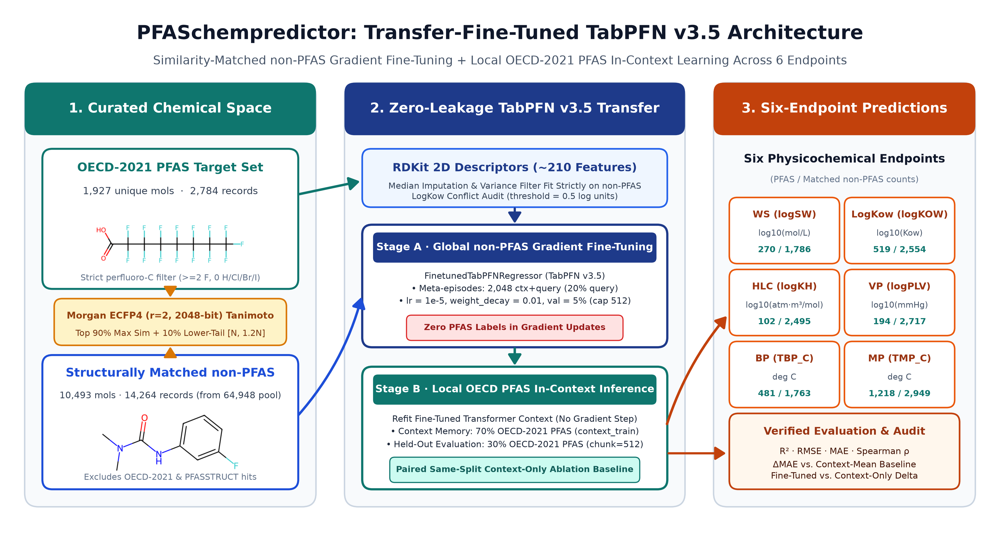
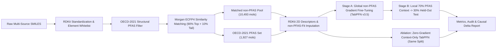
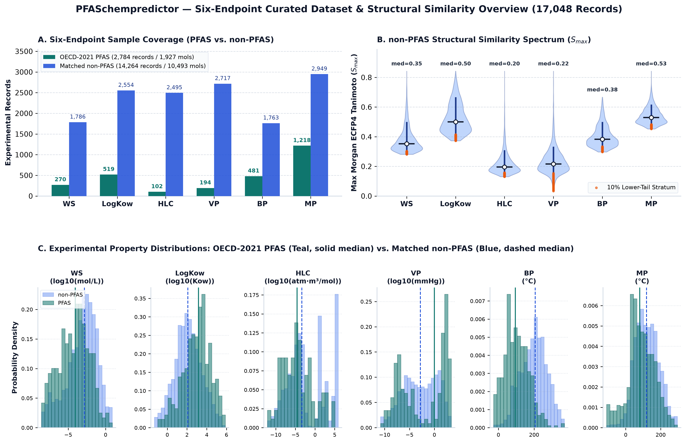

# PFASchempredictor

<p align="center">
  
</p>

<p align="center">
  <a href="https://www.python.org/"></a>
  <a href="https://www.rdkit.org/"></a>
  <a href="https://huggingface.co/Prior-Labs/tabpfn_3_5"></a>
  <a href="data/pfas_nonpfas_6endpoint_similarity_matched/metadata/DATASET_REPORT.md"></a>
  <a href="code/TabPFN/LICENSE"></a>
</p>

**PFASchempredictor** is a reproducible QSAR modeling and curated dataset repository for predicting six key physicochemical properties of **per- and polyfluoroalkyl substances (PFAS)** using **TabPFN v3.5** with **global non-PFAS gradient fine-tuning** and **local OECD-2021 PFAS in-context learning (ICL)**.

## Table of Contents

- [Motivation & Scientific Design](#motivation--scientific-design)
- [Methodology & Pipeline Architecture](#methodology--pipeline-architecture)
- [Six-Endpoint Curated Dataset](#six-endpoint-curated-dataset)
- [Repository Structure](#repository-structure)
- [Installation & TabPFN v3.5 Checkpoint Setup](#installation--tabpfn-v35-checkpoint-setup)
- [Usage & Reproducibility](#usage--reproducibility)
- [Key Hyperparameters & CLI Reference](#key-hyperparameters--cli-reference)
- [Expected Output Artifacts](#expected-output-artifacts)
- [Quick Python Data Loading Example](#quick-python-data-loading-example)
- [Troubleshooting & FAQ](#troubleshooting--faq)
- [Licensing & Citation](#licensing--citation)

---

## Motivation & Scientific Design

Predicting the environmental fate and partitioning of per- and polyfluoroalkyl substances (PFAS) is critically constrained by the scarcity of curated experimental measurements—particularly for volatility and air–water partitioning endpoints such as Henry's Law constant (`HLC`, `n = 102`) and vapor pressure (`VP`, `n = 194`). Conventional QSAR models trained solely on small PFAS collections struggle to capture both broad physicochemical trends and the unique electronic and steric perturbations induced by perfluorinated carbon chains.

**PFASchempredictor** addresses small-sample PFAS modeling through a **leakage-free, two-stage transfer learning paradigm** built on **TabPFN v3.5**:
1. **Global non-PFAS Gradient Fine-Tuning (`Stage A`)**: Adapts the TabPFN v3.5 transformer weights exclusively on large-scale, structurally matched non-PFAS molecules so the model internalizes chemical structure–property physics without ever exposing gradient updates to OECD-2021 PFAS labels.
2. **Local OECD-2021 PFAS In-Context Inference (`Stage B`)**: Freezes the fine-tuned weights, populates TabPFN's in-context memory with a `70%` OECD-2021 PFAS context set (`context_train`), and predicts the held-out `30%` OECD-2021 PFAS test set via zero-gradient few-shot adaptation.

**Key Design Principles**
- **Exact OECD-2021 Structural Separation**: Every molecule is programmatically classified with the strict OECD-2021 structural rule (`>= 2` fluorine neighbors on a carbon atom with `0` attached hydrogens and no `H/Cl/Br/I` halogen neighbors), while non-PFAS candidate pools exclude both OECD-2021 structural hits and PFASSTRUCT/list matches.
- **Top-90% + 10% Lower-Tail Similarity Matching**: Per endpoint, non-PFAS molecules are ranked by maximum Morgan ECFP4 (radius 2, 2048-bit) Tanimoto similarity to same-endpoint PFAS (`top-3` mean similarity as tie-breaker), keeping the top `90%` plus `10%` uniformly sampled across the adjacent lower-similarity rank band `[N, 1.2N]`. This preserves chemical diversity and prevents narrow-neighborhood overfitting while shifting mean maximum similarity by only `-0.0007` to `-0.0024`.
- **Causal Same-Split Ablation**: A dedicated zero-gradient context-only baseline (`run_oecd_pfas_context_only_tabpfn_same_split.py`) evaluates pretrained TabPFN v3.5 on the exact identical `context_train`/`test` split and feature reference to isolate the net transfer-learning gain.

---

## Methodology & Pipeline Architecture



### 1. Chemical Standardization & OECD-2021 Classification (`chemistry.py`, `build_oecd2021_pfas_6endpoint_wide.py`)
- Molecules are parsed with RDKit, neutralized (`RemoveHs`), canonicalized to `qsar_smiles`, assigned InChIKeys and Murcko scaffolds (`MurckoScaffoldSmiles`), and filtered against an explicit organic/environmental element whitelist: `{C, H, O, N, F, Cl, Br, I, S, P, Si, As, Hg, Sn}`.
- `oecd2021_pfas()` enforces the exact OECD-2021 structural definition (requiring at least one perfluorinated carbon with `>= 2` fluorine neighbors and no attached `H`, `Cl`, `Br`, or `I`).

### 2. Experimental Conflict Auditing (`filter_logkow_conflicts`)
- When merging multi-source experimental `logKOW` tables (e.g., core six-endpoint curation + TL-MT-Bio S7), replicate measurements for identical canonical `qsar_smiles` are audited against **`LOGKOW_CONFLICT_THRESHOLD = 0.5`** log units:
  - Spread `<= 0.5`: retains the median (`kept_within_threshold`).
  - Spread `> 0.5` with `>= 3` replicates: removes rows deviating `> 0.5` from the median if the remaining subset falls within `<= 0.5` (`removed_outlier_rows`).
  - Unresolvable conflicts: strictly discarded (`discarded_ambiguous_conflict`) and logged to `logkow_tl_s7_merge_conflict_audit.csv`.

### 3. Leakage-Free Feature Preprocessing & Two-Stage Transfer (`run_oecd_pfas_nonpfas_finetuned_tabpfn.py`)
- **Descriptors**: All RDKit 2D molecular descriptors (`Descriptors.descList`, ~210 numeric descriptors) are cached once in `rdkit2d_descriptor_cache.npz`. Median imputation and non-constant feature filtering (`prepare_features`) are fit **strictly on the non-PFAS training partition** before transforming OECD PFAS rows.
- **Stage A (Gradient Fine-Tuning)**: `FinetunedTabPFNRegressor` fine-tunes TabPFN v3.5 on non-PFAS molecules using episodic context+query batches (`2,048` samples, `20%` query ratio, `lr = 1e-5`, `weight_decay = 0.01`, `5%` validation split capped at `512` labels).
- **Stage B (In-Context Inference)**: The fine-tuned inference regressor fits its in-context memory on `70%` OECD-2021 PFAS (`context_train`) and predicts the held-out `30%` OECD-2021 PFAS (`test`) in configurable chunks (`--prediction-chunk-size 512`), evaluating `R²`, `RMSE`, `MAE`, `Spearman ρ`, and `MAE improvement vs. context-mean baseline`.

### 4. Exact-Split Causal Ablation (`run_oecd_pfas_context_only_tabpfn_same_split.py`)
- Reloads the exact `merged_6endpoint_wide_with_tl_logkow.csv`, `rdkit2d_descriptor_cache.npz`, and `oecd_pfas_context_split` from a Stage-A/B run directory (`--source-run`), runs the unmodified pretrained TabPFN v3.5 checkpoint with zero gradient updates (`--feature-reference nonpfas` by default), and exports side-by-side `delta_r2`, `delta_mae`, and `delta_rmse` metrics (`comparison_with_nonpfas_finetuned.csv`).

---

## Six-Endpoint Curated Dataset

<p align="center">
  
</p>

All six physicochemical endpoints were curated with strict per-endpoint canonical SMILES deduplication (`17,048` total endpoint records across `12,420` unique molecules: `1,927` OECD-2021 PFAS + `10,493` structurally matched non-PFAS drawn from `64,948` ranked candidates).

| Property | Internal Task Name | Unit | PFAS (`n`) | Matched non-PFAS (`n`) | Candidate Pool | Median Selected $S_{\max}$ | Range $[S_{\min}, S_{\max}]$ | Mean $S_{\max}$ Delta (`r2 - r1`) |
|---|---|---|---:|---:|---:|---:|---|---:|
| **WS** (Aqueous Solubility) | `logSW` | `log10(mol/L)` | 270 | 1,786 | 9,061 | 0.3519 | `[0.2812, 0.8421]` | `-0.000738` |
| **LogKow** (Octanol–Water Partition) | `logKOW` | `log10(Kow)` | 519 | 2,554 | 15,033 | 0.5000 | `[0.3725, 0.8421]` | `-0.001383` |
| **HLC** (Henry's Law Constant) | `logKH` | `log10(atm*m3/mol)` | 102 | 2,495 | 3,480 | 0.1957 | `[0.1304, 0.8421]` | `-0.000932` |
| **VP** (Vapor Pressure) | `logPLV` | `log10(mmHg)` | 194 | 2,717 | 3,188 | 0.2157 | `[0.0328, 0.8421]` | `-0.002392` |
| **BP** (Boiling Point) | `TBP_C` | `deg C` | 481 | 1,763 | 6,350 | 0.3824 | `[0.2973, 0.6667]` | `-0.001173` |
| **MP** (Melting Point) | `TMP_C` | `deg C` | 1,218 | 2,949 | 27,836 | 0.5294 | `[0.4524, 0.8421]` | `-0.000933` |
| **Total Records / Unique SMILES** | — | — | **2,784 / 1,927** | **14,264 / 10,493** | **64,948** | — | — | — |

- **Long tables** (`tables/{pfas,nonpfas,combined}_long.csv`): 15 columns (`property`, `source_endpoint`, `unit`, `smiles`, `raw_smiles`, `value`, `compound_class`, `pfas_source`, `source_record_id`, `source_dataset`, `est_is_fluorinated_local`, `selection_rank`, `max_morgan_tanimoto`, `top3_mean_morgan_tanimoto`, `selection_stratum`).
- **Wide tables** (`tables/{pfas,nonpfas,combined}_wide.csv`): 7 columns (`SMILES`, `WS`, `LogKow`, `HLC`, `VP`, `BP`, `MP`).
- Detailed provenance, PFAS supplementation audit, and SHA-256 input checksums are available in [`DATASET_REPORT.md`](data/pfas_nonpfas_6endpoint_similarity_matched/metadata/DATASET_REPORT.md) and [`run_manifest.json`](data/pfas_nonpfas_6endpoint_similarity_matched/metadata/run_manifest.json).

---

## Repository Structure

```text
PFASchempredictor/
├── README.md                                  # Project documentation & reproduction guide
├── .gitignore                                 # Excludes downloaded checkpoints, runs/, and Python caches
├── download_tabpfn35_weight.sh                # Downloads & SHA-256-verifies TabPFN-v3.5 weights from Hugging Face
├── docs/
│   └── assets/
│       ├── pfaschempredictor_architecture.png # 300-DPI methodology & transfer pipeline diagram
│       └── dataset_6endpoint_overview.png     # 300-DPI dataset coverage, Tanimoto spectra & property distributions
├── code/
│   ├── pfas_qsar_minchange_code/              # Core PFAS QSAR modeling & preprocessing codebase
│   │   ├── requirements.txt                   # Python dependencies
│   │   └── src/
│   │       ├── __init__.py
│   │       ├── chemistry.py                   # SMILES standardization, neutralization, InChIKey & Murcko scaffolds
│   │       ├── build_oecd2021_pfas_6endpoint_wide.py
│   │       │                                  # OECD-2021 structural PFAS classifier & 6-endpoint wide-table builder
│   │       ├── run_pfas_random_tabpfn.py      # PFAS-only random-split TabPFN + RDKit2D baseline
│   │       ├── run_oecd_pfas_nonpfas_finetuned_tabpfn.py
│   │       │                                  # Global non-PFAS fine-tuning + local OECD PFAS in-context inference
│   │       └── run_oecd_pfas_context_only_tabpfn_same_split.py
│   │                                          # No-gradient context-only TabPFN ablation on exact identical splits
│   └── TabPFN/                                # Vendored TabPFN v3.5 library (pyproject.toml, LICENSE, src/tabpfn/)
├── data/
│   └── pfas_nonpfas_6endpoint_similarity_matched/
│       ├── scripts/
│       │   └── build_dataset.py               # Exact-size Morgan-Tanimoto similarity-matched dataset builder
│       ├── tables/
│       │   ├── combined_long.csv              # 17,048 PFAS + non-PFAS endpoint records (long format)
│       │   ├── combined_wide.csv              # 12,420 unique molecules × 6 endpoints (wide format)
│       │   ├── pfas_long.csv                  # 2,784 PFAS endpoint records (long format)
│       │   ├── pfas_wide.csv                  # 1,927 unique PFAS molecules (wide format)
│       │   ├── nonpfas_long.csv               # 14,264 matched non-PFAS records (long format)
│       │   ├── nonpfas_wide.csv               # 10,493 unique non-PFAS molecules (wide format)
│       │   ├── nonpfas_all_candidates_ranked.csv
│       │   │                                  # Full 64,948-row non-PFAS candidate pool with similarity ranks & flags
│       │   └── pfas_nonpfas_similarity_matched.xlsx
│       │                                      # Multi-sheet Excel workbook (summary + per-endpoint sheets)
│       ├── by_property/
│       │   ├── pfas/                          # Endpoint-specific PFAS CSVs: WS, LogKow, HLC, VP, BP, MP
│       │   └── non_pfas/                      # Endpoint-specific matched non-PFAS CSVs: WS, LogKow, HLC, VP, BP, MP
│       └── metadata/
│           ├── DATASET_REPORT.md              # Detailed dataset construction & audit report (Chinese)
│           ├── matched_counts.csv             # Exact PFAS vs. non-PFAS counts per endpoint
│           ├── comparison_with_r1.csv         # Comparison between r2 (90%+10% tail) and r1 (strict top-N)
│           └── run_manifest.json              # Full provenance, source SHA-256 digests, and build audit
└── models/
    ├── config.json                            # TabPFN-v3.5 configuration stub
    ├── WEIGHT_DOWNLOAD.txt                    # Official Hugging Face URL & SHA-256 checksum
    └── TABPFN-3.5-LICENSE.txt                 # Prior Labs TabPFN-3.5 license terms
```

---

## Installation & TabPFN v3.5 Checkpoint Setup

### 1. Environment & Dependencies

Python `>= 3.10` with CUDA-enabled PyTorch (`>= 2.2`) is recommended for TabPFN v3.5 fine-tuning.

```bash
conda create -n pfaschempredictor python=3.11 -y
conda activate pfaschempredictor

# Install modeling dependencies
pip install -r code/pfas_qsar_minchange_code/requirements.txt
pip install huggingface_hub

# Optional: install vendored TabPFN in editable mode (scripts also auto-resolve code/TabPFN/src)
pip install -e code/TabPFN --no-deps
```

### 2. Download Official TabPFN v3.5 Weights

The TabPFN v3.5 checkpoint is hosted on Hugging Face under gated access (`Prior-Labs/tabpfn_3_5`) and is excluded from Git. Accept the model license at [`Prior-Labs/tabpfn_3_5`](https://huggingface.co/Prior-Labs/tabpfn_3_5), authenticate via CLI, and run the verified downloader:

```bash
huggingface-cli login
./download_tabpfn35_weight.sh
```

The script downloads `models/tabpfn-v3.5-20260909.safetensors` and verifies its SHA-256 digest (`ece4d67eadfea42eb0e610df5189bea60cb7f31073d81e9c7a019b76eacf0be3`). See [`models/WEIGHT_DOWNLOAD.txt`](models/WEIGHT_DOWNLOAD.txt) for direct URLs.

---

## Usage & Reproducibility

All modeling scripts automatically locate `code/TabPFN/src` and `models/tabpfn-v3.5-20260909.safetensors` relative to the repository root (overridable via `TABPFN_SRC` and `TABPFN_CHECKPOINT`).

### 1. Global non-PFAS Gradient Fine-Tuning + Local OECD PFAS Inference

```bash
PYTHONPATH=code/pfas_qsar_minchange_code \
python code/pfas_qsar_minchange_code/src/run_oecd_pfas_nonpfas_finetuned_tabpfn.py \
  --main-wide <path/to/main_6endpoint_wide.csv> \
  --hlc-wide <path/to/hlc_wide.csv> \
  --tl-logkow-xlsx <path/to/tl_logkow.xlsx> \
  --checkpoint models/tabpfn-v3.5-20260909.safetensors \
  --outdir runs/oecd2021_pfas_nonpfas_finetuned_tabpfn \
  --device cuda
```

### 2. Exact-Split No-Gradient Context-Only TabPFN Ablation

```bash
PYTHONPATH=code/pfas_qsar_minchange_code \
python code/pfas_qsar_minchange_code/src/run_oecd_pfas_context_only_tabpfn_same_split.py \
  --source-run runs/oecd2021_pfas_nonpfas_finetuned_tabpfn \
  --checkpoint models/tabpfn-v3.5-20260909.safetensors \
  --outdir runs/oecd2021_pfas_context_only_baseline \
  --feature-reference nonpfas \
  --device cuda
```

### 3. PFAS-Only Random-Split TabPFN Baseline

Evaluates TabPFN v3.5 directly on a multi-endpoint PFAS wide table containing a `qsar_smiles` column (e.g., produced by `build_oecd2021_pfas_6endpoint_wide.py`, or after renaming `SMILES` → `qsar_smiles` in `tables/pfas_wide.csv`):

```bash
PYTHONPATH=code/pfas_qsar_minchange_code \
python code/pfas_qsar_minchange_code/src/run_pfas_random_tabpfn.py \
  --wide-csv <path/to/pfas_wide_with_qsar_smiles.csv> \
  --checkpoint models/tabpfn-v3.5-20260909.safetensors \
  --outdir runs/pfas_random_tabpfn \
  --tasks TBP_C TMP_C logSW logPLV logKOW \
  --device cuda
```

### 4. Rebuilding the Similarity-Matched Dataset (Optional)

```bash
python data/pfas_nonpfas_6endpoint_similarity_matched/scripts/build_dataset.py \
  --pfas-base <path/to/current_pfas_6endpoint_distribution_input.csv> \
  --pfas-supplement <path/to/EST_PFAS_supplementary_structure_endpoint_records_444.csv> \
  --annotated-long <path/to/six_endpoint_oecd2021_annotated_long.csv> \
  --outdir data/pfas_nonpfas_6endpoint_similarity_matched_rebuilt
```

---

## Key Hyperparameters & CLI Reference

| CLI Argument | Default | Applicable Script(s) | Purpose |
|---|---:|---|---|
| `--pfas-test-fraction` | `0.30` | `run_oecd_pfas_nonpfas_finetuned_tabpfn.py` | Fraction of OECD-2021 PFAS molecules held out as `test` (`70%` kept as `context_train`). |
| `--epochs` | `1` | `run_oecd_pfas_nonpfas_finetuned_tabpfn.py` | Number of gradient fine-tuning epochs over non-PFAS meta-episodes. |
| `--learning-rate` | `1e-5` | `run_oecd_pfas_nonpfas_finetuned_tabpfn.py` | AdamW learning rate for `FinetunedTabPFNRegressor`. |
| `--weight-decay` | `0.01` | `run_oecd_pfas_nonpfas_finetuned_tabpfn.py` | L2 regularization weight during non-PFAS gradient fine-tuning. |
| `--n-finetune-ctx-plus-query-samples` | `2048` | `run_oecd_pfas_nonpfas_finetuned_tabpfn.py` | Episode size (context + query rows) per fine-tuning step; lower to reduce VRAM. |
| `--finetune-query-ratio` | `0.20` | `run_oecd_pfas_nonpfas_finetuned_tabpfn.py` | Fraction of each fine-tuning episode used as query loss targets. |
| `--validation-fraction` | `0.05` | `run_oecd_pfas_nonpfas_finetuned_tabpfn.py` | non-PFAS validation holdout fraction during fine-tuning (capped by `--max-validation-labels 512`). |
| `--n-inference-subsample-samples` / `--subsample-samples` | `10000` | All TabPFN runners | TabPFN `SUBSAMPLE_SAMPLES` inference context budget. |
| `--prediction-chunk-size` | `512` | All TabPFN runners | Test-set batch size during in-context inference (controls peak GPU memory). |
| `--feature-reference` | `nonpfas` | `run_oecd_pfas_context_only_tabpfn_same_split.py` | Fit RDKit2D imputation/filtering on `nonpfas` (matches fine-tuned run) or `context` only. |
| `--seed` | `20260616` | OECD fine-tune & ablation runners | Deterministic seed controlling OECD PFAS split and endpoint-specific subsampling. |

---

## Expected Output Artifacts

Running `run_oecd_pfas_nonpfas_finetuned_tabpfn.py` writes a fully auditable experiment directory under `--outdir`:

```text
<outdir>/
├── merged_6endpoint_wide_with_tl_logkow.csv   # Merged 6-endpoint wide table with OECD-2021 flags & split roles
├── oecd2021_pfas_context_split_wide.csv       # OECD-2021 PFAS subset with context_train / test assignments
├── logkow_tl_s7_merge_conflict_audit.csv      # Row-level audit of duplicate logKOW conflict resolution (0.5 threshold)
├── rdkit2d_descriptor_cache.npz               # Cached RDKit 2D descriptor matrix + feature names + invalid SMILES indices
├── endpoint_finetune/
│   └── <endpoint>/                            # Per-endpoint directory (TBP_C, TMP_C, logSW, logPLV, logKOW, logKH)
│       └── feature_metadata.json              # Selected non-constant RDKit2D features & imputation stats
├── metrics.csv                                # Final per-endpoint R², RMSE, MAE, Spearman & ΔMAE vs. context mean
├── metrics_partial.csv                        # Incremental checkpoint updated after each endpoint completes
├── predictions.csv                            # Held-out OECD PFAS predictions, targets, baselines & absolute errors
├── summary.json                               # Full run provenance, argv, dataset stats & metrics JSON
└── REPORT.md                                  # Auto-generated Markdown summary report
```

Running the paired ablation script (`run_oecd_pfas_context_only_tabpfn_same_split.py`) additionally generates:
- `comparison_with_nonpfas_finetuned.csv` — side-by-side table computing `delta_r2_finetuned_minus_context_only`, `delta_mae_finetuned_minus_context_only`, and `delta_rmse_finetuned_minus_context_only` across all six endpoints.

---

## Quick Python Data Loading Example

```python
import pandas as pd

# 1. Load unified long table (17,048 records across 6 physicochemical endpoints)
long_df = pd.read_csv(
    "data/pfas_nonpfas_6endpoint_similarity_matched/tables/combined_long.csv"
)
print(f"Total records: {len(long_df):,} | Unique SMILES: {long_df['smiles'].nunique():,}")

# 2. Cross-tabulate PFAS vs. matched non-PFAS counts per endpoint
counts = long_df.groupby(["property", "compound_class"]).size().unstack(fill_value=0)
print("\nEndpoint counts (PFAS vs. non-PFAS):\n", counts)

# 3. Inspect similarity strata for matched non-PFAS molecules
nonpfas = long_df.loc[long_df["compound_class"] == "Non-PFAS"]
print(
    "\nnon-PFAS similarity summary (median S_max by endpoint & stratum):\n",
    nonpfas.groupby(["property", "selection_stratum"])["max_morgan_tanimoto"]
    .agg(["count", "median", "min", "max"])
    .round(4),
)

# 4. Load wide PFAS matrix (1,927 unique molecules × 6 properties)
pfas_wide = pd.read_csv(
    "data/pfas_nonpfas_6endpoint_similarity_matched/tables/pfas_wide.csv"
)
print(f"\nWide PFAS matrix shape: {pfas_wide.shape}")
```

---

## Troubleshooting & FAQ

- **Hugging Face `401 / 403` when downloading TabPFN v3.5**: `Prior-Labs/tabpfn_3_5` is a gated model. Visit the [model card](https://huggingface.co/Prior-Labs/tabpfn_3_5) while logged into Hugging Face, accept the license terms, then run `huggingface-cli login` before executing `./download_tabpfn35_weight.sh`.
- **CUDA Out-of-Memory (OOM) during fine-tuning or inference**: Reduce `--n-finetune-ctx-plus-query-samples` (e.g., from `2048` to `1024`) for Stage-A fine-tuning, and/or reduce `--prediction-chunk-size` (e.g., from `512` to `128`) for Stage-B inference. Each script automatically clears PyTorch CUDA caches (`torch.cuda.empty_cache()`) between endpoints.
- **`ValueError: wide CSV must contain qsar_smiles`**: The modeling scripts (`run_pfas_random_tabpfn.py`, `run_oecd_pfas_nonpfas_finetuned_tabpfn.py`) expect the canonical SMILES column to be named `qsar_smiles`, whereas the published dataset wide tables (`tables/*_wide.csv`) use `SMILES`. Rename `SMILES` → `qsar_smiles` (and map column names `WS, LogKow, HLC, VP, BP, MP` if using default task names) when feeding `tables/pfas_wide.csv` directly into `run_pfas_random_tabpfn.py`.
- **Using an externally installed TabPFN or custom checkpoint path**: Override automatic repository-relative resolution with environment variables `TABPFN_SRC=/path/to/TabPFN/src` and `TABPFN_CHECKPOINT=/path/to/checkpoint.safetensors`.

---

## Licensing & Citation

- **TabPFN v3.5 Code**: Vendored under `code/TabPFN/` per [`code/TabPFN/LICENSE`](code/TabPFN/LICENSE) and [`code/TabPFN/NOTICE`](code/TabPFN/NOTICE).
- **TabPFN v3.5 Checkpoint Weights**: Governed by the Prior Labs TabPFN-3.5 License ([`models/TABPFN-3.5-LICENSE.txt`](models/TABPFN-3.5-LICENSE.txt)).
- **PFAS QSAR Code & Curated Datasets**: Released for reproducible environmental chemistry and cheminformatics research.

If you use **PFASchempredictor** or the six-endpoint similarity-matched PFAS / non-PFAS dataset in academic work, please cite:

```bibtex
@software{zjhkeyan_pfaschempredictor_2026,
  author  = {zjhkeyan},
  title   = {PFASchempredictor: Transfer-Fine-Tuned TabPFN v3.5 and Six-Endpoint Similarity-Matched Dataset for OECD-2021 PFAS Property Prediction},
  year    = {2026},
  url     = {https://github.com/zjhkeyan/PFASchempredictor}
}
```
